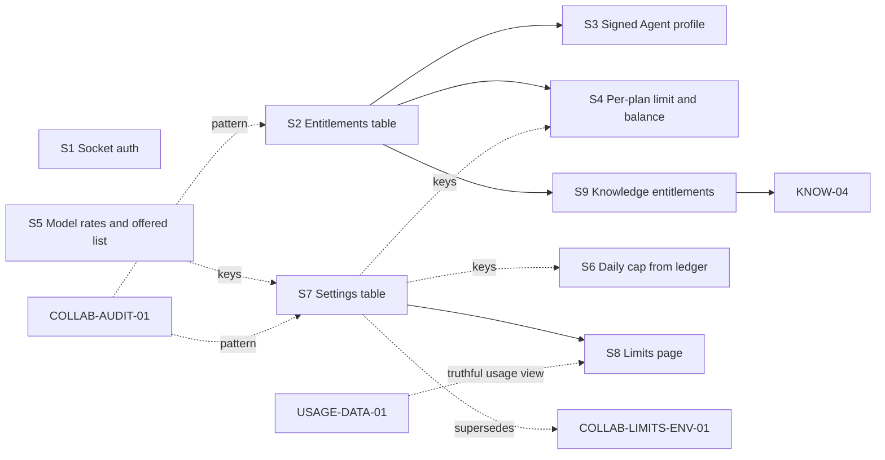

# GOV-ACCESS-PLAN-01 — Ready for users other than Keith

**Status:** approved by Keith on 2026-11-05 with decisions D1 to D7 as recommended and the control-plane notes below. Registrations in docs/GOV-ACCESS-PLAN-01-CHECKPOINT.md.

## 1. Summary and recommendation

Today every gate that separates Keith from "anyone else" is either process-wide or absent: one env allowlist decides who sees Agent mode, the Team page and the knowledge base (`services/api-gateway/src/auth/session-or-api-key.guard.ts:13-40`); one env flag opens write tools for every harness run in the process (`services/ai-service/src/agent-harness/config/agent-harness.config.ts:49-53`); one token limit applies to every user (`services/api-gateway/src/quota/quota.config.ts:48-49`); Socket.IO rooms have no authentication (`services/api-gateway/src/websocket/websocket.gateway.ts:31-36`); and the platform daily spend cap is inert because nothing in production calls `recordExecutionCost` (grep of `services/` excluding specs finds only the definition at `global-safety-limit.service.ts:85`).

Agent runs **are already charged**: Agent mode sends `executionIntent: conversation` (ARCHITECTURE.md line 928), the harness loop reports cumulative tokens (`agent-harness-loop.ts:355,406`), and finalize deducts `model_tokens` at 1 credit per started 1K (`usage-ledger.service.ts:762-817, 1010-1016`; COLLAB-LIVE-06 checkpoint line 19 shows 300 to 279). What is missing is model-aware pricing, per-plan limits and a balance check that covers a run rather than `balance > 0` (`credit-balance.guard.ts:79`).

**Required before a second trusted user (unpaid):** per-user entitlements replacing the env allowlist and the global write flag (items 3), authenticated or disabled Socket.IO (item 4), a per-plan daily token limit plus a sufficient-balance check (item 1), a daily cap that actually counts (item 6), a disclosure decision on `previous_response_id` (item 5), and one staging live check with a second account.

**Can wait for a paid launch:** credits by model and a curated model list (item 2), the admin Limits page and settings table (item 8), knowledge entitlements and charging (item 7), stateless provider continuation (item 5 implementation), and Stripe (PRD.md section 3.H, already PLANNED).

## 2. What exists today

| Item | Exists | Citation | Gap |
|---|---|---|---|
| 1 Limit | `TokenQuotaGuard` on `POST /api/ai/execute` sums `usage_records.tokens_used` per user over 24 h against one global `MAX_TOKENS_PER_24H` (default 1,000,000, env) | `ai-execution.controller.ts:720`; `token-quota.guard.ts:96-111`; `quota.config.ts:48-49`; HARNESS-QUOTA-01 checkpoint line 42 | Same limit for all plans; no admin bypass; estimate is 8,000 tokens (`quota.config.ts:141`) while an Agent run may use 60,000 (`agent-harness.config.ts:69`) |
| 1 Balance | `CreditBalanceGuard` requires balance > 0; admins bypass | `credit-balance.guard.ts:58-60, 79` | A 1-credit balance admits a 60-credit run; overflow recorded, not prevented (`usage-ledger.service.ts:1047`) |
| 1 Plans | `PLAN_DEFINITIONS` free/starter/pro/team with 500/5,000/25,000/100,000 credits; `credit_balances.plan_id` default `free`; registration provisions free | `plan-definitions.config.ts`; `plan-definition.ts:14-19`; `credit-balance.entity.ts:41-42`; `auth.service.ts:405-410` | No token-limit field per plan; nothing reads entitlements at runtime |
| 2 Rates | One `model_tokens` rate, 1 credit per 1K, version `2026-07-v1` | `credit-rates.config.ts:11-19`; CREDIT-UNIT-01 checkpoint | No per-model rate; `tool_call` and other rates defined but unused (`credit-rates.config.ts:20-68`) |
| 2 Models | AI-service catalogue lists 2 xAI, 2 Groq, 3 DeepSeek, 5 OpenAI, 4 Anthropic; frontend catalogue marks all selectable except grok-4.20, deepseek-v4-flash, stub | `services/ai-service/src/ai-execution/provider-model.catalogue.ts:51-61`; `frontend/lib/ai/provider-model.catalogue.ts` | No server-side "offered" list per plan; two catalogues kept in step by hand |
| 3 Write flag | `AGENT_HARNESS_ENABLE_WRITE_TOOLS` read once from env; worker registers `write_file`/`delete_file` for Agent mode when the flag is on and the run is not read-only | `agent-harness.config.ts:49-53, 101-102`; `worker.processor.ts:1803-1848` | Opening the flag for a collaboration Writer opens Agent writes for everyone (COLLAB-LIVE-06 line 23) |
| 3 Entitlement | `AGENT_HARNESS_BROWSER_SESSION_USER_IDS` sets `harnessEntitled`; gates execute with `harnessVersion`, collaboration routes, knowledge routes and the Agent-mode UI via `/api/auth/me` | `session-or-api-key.guard.ts:13-40, 87-89`; `ai-execution.controller.ts:746`; `collaboration.controller.ts:303`; `knowledge.controller.ts:147`; `auth.controller.ts:378` | Env-only, restart to change, one boolean for three features |
| 4 Socket.IO | `join-session` joins any room; no auth on connect; CORS `origin: true`; events fed by `POST /api/events/*` | `websocket.gateway.ts:12-36`; `events.controller.ts` | Any connected client can receive another session's `file-changed` and `checkpoint-created`. No frontend code opens a socket (`Timeline.tsx` takes a socket prop; nothing imports it); Caddy sends `/socket.io` to the frontend (AUTH-OWNER-01 line 53) |
| 5 Retention | OpenAI and xAI tool continuation uses `previous_response_id` with `store: true`; continuation throws without a response id | `adapter-tool-use.mapper.ts:471-479`; `openai-ai.adapter.ts:215-237`; `xai-ai.adapter.ts:215-237` | Conversation state, including file contents returned by tools, is stored at the provider. Anthropic and DeepSeek replay the transcript (HARNESS-PROVIDERS-01 slices 1 and 3) |
| 6 Daily spend | In-memory `dailySpendWindow`, USD caps 10,000 soft / 20,000 hard | `global-safety-limit.service.ts:36-40, 85-108, 206-226`; `global-safety-limits.config.ts:33-43`; COLLAB-GATE-01 line 30 | Resets on restart, and no production caller records cost, so the cap never triggers; no USD price source exists |
| 7 Knowledge | Plan `knowledgeAccess` defined (free: ingestion off, 0 items); service enforces fixed 50 documents / 4 MB per account | `plan-definitions.config.ts:28-32, 55-59, 82-86, 109-113`; `knowledge-content.ts:9-11`; `knowledge.service.ts:71-77, 133` | Entitlements never read; no `knowledge_ingestion` charge |
| 8 Admin | `/api/admin/*` behind `SessionCookieGuard` + `AdminRoleGuard` (role must be `admin`); role enum user/admin/beta, default user; admin page fetches `/api/auth/me` then `/api/admin/users` | `admin-operational.controller.ts:42`; `admin-role.guard.ts:19`; `user.entity.ts:60-65`; `migrations/1769160618009-InitSchema20260123.ts:7`; `frontend/components/admin/admin-page-client.tsx:141, 207` | No route or migration assigns admin (assumption: set by direct DB update); all limits are static env values read at process start, so edits need a restart |

## 3. Design per item

**Item 1 — per-plan limit and sufficient balance.** Add `dailyTokenLimit` to each `PlanDefinition`; `TokenQuotaGuard` resolves the caller's plan from `credit_balances.plan_id` and uses that limit, with a per-user override column (from item 3's table) winning when set, and admin bypass matching `CreditBalanceGuard`. For Agent runs (`harnessVersion` present) the estimate becomes `maxRunTokens` (60,000); `CreditBalanceGuard` requires `balance >= ceil(estimate/1000)` instead of `> 0`. No migration beyond item 3's. Security: limits read server-side only; 429/402 bodies unchanged in shape. Tests: guard specs per plan and override, Agent estimate, admin bypass.

**Item 2 — credits by model, offered models.** Extend the rate config with a `modelRates` map (`provider:model` to credits per 1K) falling back to the 1-credit base; bump `CREDIT_RATE_VERSION`; `emitDeductionAttempt` passes `record.model` so `CreditCalculationService` picks the rate (requires `usage_records.model` populated; USAGE-MODEL-01 is locked and appears to cover this — assumption). Add a gateway `GET /api/ai/models` returning the offered models for the caller's plan; the frontend catalogue's `selectable` flags come from it, and the gateway rejects a model not offered to the caller before enqueue. No migration. Security: server-side enforcement; rates shown on the Billing page. Tests: rate lookup, version, rejection of unoffered models, frontend catalogue fallback.

**Item 3 — per-user entitlements and signed Agent profile.** Migration: `user_entitlements` (user_id PK, harness_enabled, agent_write_enabled, plan_override, daily_token_limit_override, updated_by, updated_at). `SessionOrApiKeyAuthGuard` and `/api/auth/me` read `harnessEntitled` from the table; the env allowlist is removed after a one-time admin set (two-step cutover). The gateway signs a tool profile for Agent runs (`agent-write` or `read`) the way collaboration already signs `signedToolProfile` (`worker.processor.ts:1706-1720`), and the worker registers write tools for Agent mode only when the signed profile allows **and** the process flag is on. The env flag becomes a global kill switch, not the grant. Shared contract: the job payload (freeze before the two lanes). Security: HMAC-signed profile (existing mechanism, assumption), admin-only write route. Tests: guard reads table, worker refuses unsigned write, flag off still refuses, audit row per change.

**Item 4 — Socket.IO.** Authenticate the handshake from the `aisandbox_session` cookie via `AuthService.validateSessionToken` and owner-check `join-session` against `SessionService` (404-equivalent refusal); set CORS to the configured origin. Verify `POST /api/events/*` is covered by the internal-key guard (no decorator visible in `events.controller.ts`; assumption that a module-level guard exists — if not, add it in the same slice). No migration. Tests: unauthenticated connect disconnected; foreign session join refused; owner join succeeds.

**Item 5 — previous_response_id.** Option A: stateless continuation for OpenAI and xAI (`store: false`, replay prior `function_call` items and outputs in `input`), keeping Anthropic/DeepSeek unchanged. Option B: keep storage and disclose it in the Agent-mode UI (i18n) with a per-user opt-in. Recommend B for one trusted user, A before paid launch. Tests: mocked request shape; live check on staging because replay may change reasoning behaviour.

**Item 6 — daily cap that survives restart.** Replace the in-memory counter with a query: platform and per-user credits deducted today (UTC) from `credit_deduction_records` (assumption: it has a creation timestamp). Caps move to credits (`MAX_DAILY_CREDITS_PLATFORM`, `MAX_DAILY_CREDITS_PER_USER`), env defaults now, settings keys later (item 8). `ExecutionSafetyGuard` and the collaboration approve path (`orchestration.service.ts:1701`) use it unchanged. No migration. Tests: cap reached from stored rows, reset at UTC day, restart-independence by construction.

**Item 7 — knowledge entitlements and charging.** An `EntitlementService` resolving plan from `credit_balances.plan_id` plus item 3 overrides. Knowledge create/replace checks `ingestionEnabled` and counts documents created this calendar month against `maxKnowledgeItemsPerMonth`; a changed hash charges `knowledge_ingestion` through the existing deduction gateway with `sourceEventId = documentId:sha256`. KNOW-04 reuses the same path for `knowledge_summarization`. No migration. Tests: free plan refused, monthly count boundary, idempotent charge.

**Item 8 — admin Limits page.** Migration: `platform_settings` (key PK, value jsonb, updated_by, updated_at) and append-only `platform_settings_audit`. `SettingsService` with a 30-second cache and a typed key list (token limits per plan, daily caps, offered models, the four collaboration limits); env value is the default when no row exists; server-side range validation and ceilings. `GET/PUT /api/admin/settings` behind the existing two guards. Page at `frontend/app/[locale]/admin/limits/` with en/zh-TW/zh-CN keys. Worker-side `AGENT_HARNESS_*` flags stay env (no gateway-to-worker settings contract yet). Tests: validation, audit row per change, cache refresh, 403 for non-admin.

## 4. Dependencies

- COLLAB-AUDIT-01's readiness says "before ACCESS-READY-01 is admitted"; its stored immutable audit table is the pattern S2 and S7 should reuse for entitlement and settings changes. Recommend it runs first.
- COLLAB-LIMITS-ENV-01 is superseded by S7 if its four constants become settings keys (Keith decides).
- KNOW-04 depends on S9's charging path.
- USAGE-DATA-01 item 2 (SQLite readers nothing writes) is not a blocker, but the Limits page should show usage from PostgreSQL, not those readers.

## 5. Slices in order

| Slice | Content | Size | Write scope | Mutexes | Evidence | Lifecycle |
|---|---|---|---|---|---|---|
| S1 ACCESS-01A | Socket.IO handshake auth, owner-checked join, CORS origin, verify `/api/events` guard | S | services/api-gateway/src/websocket/, services/api-gateway/src/auth/ (read only), frontend/components/Timeline.tsx (remove dead prop, optional) | GATEWAY | LOCAL-TESTS | 4-STEP (security; short stage-start) |
| S2 ACCESS-01B | `user_entitlements` migration, admin set route, `harnessEntitled` from table, env allowlist cutover | M | services/api-gateway/src/entities/, services/api-gateway/src/migrations/, services/api-gateway/src/auth/, services/api-gateway/src/admin/ | GATEWAY, MIGRATION, ENV | LOCAL-TESTS | 4-STEP (migration, auth) |
| S3 ACCESS-01C | Signed Agent tool profile; worker honours it; env flag becomes kill switch | M | services/api-gateway/src/ai/, services/ai-service/src/worker/, services/ai-service/src/agent-harness/contracts/ | GATEWAY, AI-SERVICE | LOCAL-TESTS | 4-STEP (shared contract freeze) |
| S4 ACCESS-01D | Per-plan daily token limit, Agent estimate, sufficient-balance check, admin bypass in TokenQuotaGuard | S | services/api-gateway/src/quota/, services/api-gateway/src/billing/, services/api-gateway/src/credit-ledger/ | GATEWAY | LOCAL-TESTS | 3-STEP |
| S6 ACCESS-01F | Daily caps in credits from the ledger; remove in-memory counter | S | services/api-gateway/src/safety/ | GATEWAY | LOCAL-TESTS | 3-STEP |
| S11 ACCESS-LIVE-01 | Second test account on staging: Agent read-only, Agent write refused, limit and cap refusals, socket join refused, port 4000 external reachability | S | docs/ only | STAGING, PROVIDER-LIVE, CREDIT | STAGING-RUNTIME, PROVIDER-LIVE | 2-STEP |
| S5 ACCESS-01E | Per-model rates, version bump, offered-models route, frontend catalogue from server | M | services/api-gateway/src/credit-ledger/, services/api-gateway/src/billing/, services/api-gateway/src/ai/, frontend/lib/ai/, frontend/components/workspace/ | GATEWAY, FRONTEND | LOCAL-TESTS | 3-STEP |
| S7 ACCESS-01G | `platform_settings` and audit migration, SettingsService, admin routes | M | services/api-gateway/src/entities/, services/api-gateway/src/migrations/, services/api-gateway/src/admin/, services/api-gateway/src/quota/, services/api-gateway/src/safety/ | GATEWAY, MIGRATION | LOCAL-TESTS | 4-STEP |
| S8 ACCESS-01H | Limits page | S–M | frontend/app/, frontend/components/admin/, frontend/messages/ | FRONTEND, I18N | LOCAL-TESTS + Keith browser check | 3-STEP |
| S9 ACCESS-01I | EntitlementService, knowledge monthly limit and `knowledge_ingestion` charge | M | services/api-gateway/src/knowledge/, services/api-gateway/src/credit-ledger/, services/api-gateway/src/billing/ | GATEWAY, CREDIT | LOCAL-TESTS | 3-STEP |
| S10 ACCESS-01J | Stateless Responses continuation for OpenAI and xAI (or disclosure UI if B) | M | services/ai-service/src/ai-execution/adapters/ (A) or frontend/components/workspace/ + frontend/messages/ (B) | AI-SERVICE or FRONTEND+I18N | LOCAL-TESTS then PROVIDER-LIVE | 3-STEP |

**First slice: S1 ACCESS-01A**, write scope `services/api-gateway/src/websocket/` (plus a read of `services/api-gateway/src/auth/`), GATEWAY, LOCAL-TESTS. It needs no decision from Keith and closes an open cross-user leak.

## 6. Second-user checklist

Locked and live-checked before one trusted person is invited: S1, S2, S3, S4, S6, S11, COLLAB-AUDIT-01 (Keith's own readiness condition), and Keith's decision D3 recorded (disclosure accepted or OpenAI/xAI Agent runs withheld from that user). Staging stays behind basic_auth; the second user gets a basic_auth credential and a free-plan account with an admin credit grant.

Paid launch additionally needs S5, S7, S8, S9, S10 option A, USAGE-DATA-01, and Stripe activation (outside this plan).

## 7. Decisions for Keith

- **D1 Credits by model.** Recommend a per-model multiplier on the 1-credit-per-1K base, numbers from provider list prices, rate version bumped, shown on the Billing page. Alternative: stay flat until paid launch (cost risk on Opus-class models). Tool calls stay uncharged (tokens already cover them).
- **D2 Per-user or per-plan limit.** Recommend per-plan `dailyTokenLimit` with a per-user override; Keith sets the free-plan number (the current 1,000,000 was for testing).
- **D3 previous_response_id.** Recommend disclosure for the trusted user now, stateless replay (S10 A) before paid launch. Alternative: withhold OpenAI and xAI Agent runs from non-Keith users until S10.
- **D4 Who is admin.** Recommend Keith only, assigned by DB update as today, documented in S7's stage-start; no admin-creation route. Admin keeps the balance bypass; admin runs stay deducted.
- **D5 Plan for the second user.** Recommend free plan with an admin credit grant and S2 overrides, not a new plan; knowledge ingestion for that user via override.
- **D6 Socket.IO.** Recommend authenticate (S1); alternative is removing the gateway and changing the CM event posts.
- **D7 Daily cap unit.** Recommend credits from the ledger; USD needs a price table that does not exist.
- **Proposed PRD changes (later, not in this task):** section 3.H add per-model rates and per-plan daily limits; 3.L add the Limits page; section 11 Agent mode stays GATED until S11. **Proposed ARCHITECTURE changes:** 11.2 write-flag semantics (global AND per-user), 11.3 per-model rate, 12.1 limit row, Billing section (daily cap from ledger), Auth section (entitlements table, Socket.IO auth), section 14 WebSocket row.

## 8. Risks

- S3 changes the gateway-to-worker job contract; both services must deploy together, and the frozen contract blocks parallel lanes touching the payload.
- Migrations (S2, S7) run on the staging database for the first time at deploy; down paths must be tested.
- A wrong per-plan limit without admin bypass locks Keith out; S4 adds the bypass.
- Stateless replay (S10 A) may change OpenAI/xAI reasoning behaviour; mocks cannot prove it.
- Rate changes (S5) alter the cost of Keith's own runs; existing balances are untouched.
- Settings cache (S7) means up to 30 seconds of stale limits.
- Cutover from env allowlist to table (S2) can briefly leave nobody entitled; the slice must seed before removing.
- Port 4000 listens on all interfaces (AUTH-OWNER-01 line 53); the Caddy route for `/socket.io` goes to the frontend, so S1 matters only if the port is reachable — S11 checks.

## 9. Follow-ups named here

| Follow-up | Disposition |
|---|---|
| `recordExecutionCost` has no production caller; daily cap inert | Superseded by S6 |
| `/api/events/*` guard not visible in `events.controller.ts` | Superseded by S1 acceptance criterion |
| `TokenQuotaGuard` has no admin bypass | Superseded by S4 acceptance criterion |
| `usage_records.model` empty for provider executions (CREDIT-UNIT-01 line 68) | Superseded by S5 acceptance criterion "model populated"; verify USAGE-MODEL-01 first |
| COLLAB-LIMITS-ENV-01 | Propose superseded by S7 (its four constants become settings keys); Keith decides |
| Per-user numeric limit overrides beyond S2's columns | Register `LIMITS-PER-USER-01`, NOT_READY until S7 and S8 locked and Keith asks |
| Stateless continuation if D3 chooses disclosure | Register as S10 option A, NOT_READY: before paid launch |
| Port 4000 external reachability and firewall | Superseded by S11 checklist |
| `frontend/components/Timeline.tsx` dead socket prop | Drop (unused component; S1 makes a stray socket harmless) — Keith's drop |
| Admin assignment procedure | Superseded by S7 stage-start |

## Reviewer notes (control plane, 2026-11-05)

Drafted by Fable 5.1 (claude-fable-5-1-thinking-high, resolved "Claude Fable 5.1 300K High") through Cursor in read-only mode. Checked against the code and found correct: recordExecutionCost has no caller outside tests (only its definition at global-safety-limit.service.ts line 85), so the daily spend cap never triggers; CreditBalanceGuard admits any balance above zero and lets admins bypass; TokenQuotaGuard estimates 8,000 tokens per request; Socket.IO allows any origin and any room join; OpenAI and xAI continuation sends store: true; the harness tool profile is a job field checked by the worker.

**Resolved assumption.** POST /api/events/* is protected: the global InternalServiceAuthGuard (APP_GUARD in app.module.ts) covers the /api/events/ prefix (guards/internal-service-auth.guard.ts lines 11-12). S1 keeps a test for it; no new guard is needed.

**Correction — two slices change the same frozen contract.** S3 (signed Agent profile) and KNOW-02 (knowledgeScopes) both change the job payload under HARNESS_ENTITLEMENT_PROOF_V1. Each must follow the contract-change protocol and run alone, and they must not overlap; whichever comes first re-freezes the contract before the other starts, or the two changes are combined into one contract change.

**Note for Keith — live-window safety so far.** Because the daily spend cap never counted, the "spend caps 1 and 2 USD" written into earlier live windows did not protect anything. The real limits in those windows were the per-run token budget (MAX_TOKENS_PER_EXECUTION 16,000 and the harness run budget) and the provider key's own limit. S6 fixes the cap.

The control plane agrees with the recommendation, the second-user checklist and S1 as the first slice.

---

## Files read

- TASKS_BACKLOG_FULL.md (bodies: ACCESS-READY-01, GOV-ACCESS-PLAN-01, COLLAB-AUDIT-01, COLLAB-LIMITS-ENV-01, KNOW-04, USAGE-DATA-01)
- PRD.md sections 3.C, 3.H, 3.K, 3.L, 10, 11; ARCHITECTURE.md Authority Notice, CURRENT vs PLANNED, Auth, Billing, 11.2, 11.3, 12, 14
- services/api-gateway/src: quota/quota.config.ts, quota/token-quota.guard.ts, quota/quota.service.ts, billing/credit-balance.guard.ts, credit-ledger/config/credit-rates.config.ts, credit-ledger/config/plan-definitions.config.ts, credit-ledger/types/plan-definition.ts, credit-ledger/types/user-entitlement.ts, credit-ledger/types/credit-ledger.ts, usage-ledger/usage-ledger.service.ts (740-1070), safety/global-safety-limit.service.ts, safety/global-safety-limits.config.ts, safety/execution-safety.guard.ts, websocket/websocket.gateway.ts, websocket/events.controller.ts, auth/session-or-api-key.guard.ts, guards/admin-role.guard.ts, admin/admin-operational.controller.ts, orchestration/collaboration.controller.ts (270-320), entities/user.entity.ts (50-70); greps over ai/ai-execution.controller.ts, knowledge/, orchestration/, migrations/, entities/
- services/ai-service/src: agent-harness/config/agent-harness.config.ts, worker/worker.processor.ts (1690-1920), ai-execution/adapters/adapter-tool-use.mapper.ts (420-490), ai-execution/adapters/openai-ai.adapter.ts (200-250), ai-execution/provider-model.catalogue.ts; greps over xai-ai.adapter.ts, agent-harness/orchestrator/agent-harness-loop.ts
- frontend: lib/ai/provider-model.catalogue.ts, app/[locale]/admin/page.tsx, components/Timeline.tsx (1-60); greps over components/admin, components/office, socket usage
- docs: HARNESS-QUOTA-01, CREDIT-UNIT-01, HARNESS-PROVIDERS-01, COLLAB-LIVE-06, AUTH-OWNER-01, COLLAB-GATE-01 checkpoints

## Assumptions

- Admin role is assigned by direct database update; no route or migration found that sets it.
- `POST /api/events/*` may be covered by a module-level internal-key guard not visible in `events.controller.ts`; unverified.
- `credit_deduction_records` has a creation timestamp usable for a per-day sum; the entity was not read.
- USAGE-MODEL-01 (locked, cited in USAGE-DATA-01) populates `usage_records.model`; its checkpoint was not read.
- The collaboration `signedToolProfile` is HMAC-signed by the gateway and verifiable by the worker; the signing code was not read.
- `WebsocketModule` is imported in `app.module.ts`; not read.
- Office and Team page gating relies on `harnessEntitled` from `/api/auth/me` and the collaboration routes (office-screen.tsx fetches `/api/auth/me`; its gating logic was not read).
- Rough sizes: S under one day, M one to three days, for one implementer.